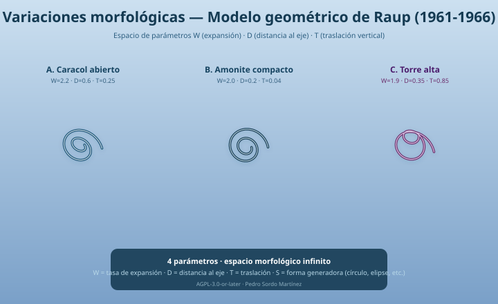

# Modelo Geométrico 🐚 — Modelo de enrollamiento espiral (Raup, 1961-1966)
<!-- SPDX-FileCopyrightText: 2026 Pedro Sordo Martínez <amurlaniakea@gmail.com> -->
<!-- SPDX-License-Identifier: AGPL-3.0-or-later -->


> **¡Hola, explorador!** Este código genera formas de concha espiral usando solo cuatro números: **W**, **D**, **T** y **S**. Es una implementación de la idea matemática que usó el paleontólogo David M. Raup en los años 60, basada en una formulación secundaria (ver [Estado del proyecto](#estado-del-proyecto)): aún no se ha contrastado con los artículos originales.

Implementación en Python del modelo geométrico de enrollamiento espiral. **Licencia:** AGPL-3.0-or-later. Ver [LICENSE](LICENSE).

## 🧭 ¿Cómo funciona? (para jóvenes curiosos)

Imagina que tienes una curva generadora (como un círculo pequeño) y la haces girar alrededor de un eje, como si envolvieras un hilo alrededor de un lápiz. Cada vuelta, la curva crece exponencialmente (`W` multiplica el radio por `W` en cada vuelta; con `W=2.0`, el valor por defecto, lo duplica, así que no es 'un poquito'), se aleja un poco del eje (`D`) y sube un poquito (`T`). ¡Así nace cualquier concha espiral!



*Figura generada con `scripts/render_figures.py` a partir de `src/model.py` (no dibujada a mano). Arriba, la vista superior; abajo, el corte sagital en θ = 0 con las tres primeras aperturas. «Clásica» y «Torre alta» tienen vueltas que se solapan; «Planispiral abierta» no (según `whorl_overlap`).*

- **W** = expansión (`whorl expansion rate`) → la concha crece más rápido.
- **D** = distancia al eje → qué tan "abierta" está la espiral.
- **T** = traslación (`translation`) → cuánto sube por cada giro, como una escalera de caracol.
- **S** = forma de la curva generadora → `circle` (rho = 1) o `ellipse` (rho = b/a). Raup no la define con precisión; esta es una decisión de diseño.

> **⚠️ ESTADO DE IMPLEMENTACIÓN (paso B aplicado):** `D` y `S` ya se usan (`generate_shell`, `whorl_overlap`); `z = T*r` (autosemejante), `generate_curve` incluye cierre. La formulación es SECUNDARIA (Filin 2026) y NO ha sido contrastada con Raup (1966) ni validada contra las figuras originales.
> **⚠️ ADVERTENCIA:** Modelo teórico para fines educativos. No sustituye análisis paleontológicos ni geológicos profesionales.

## 🖼️ Visualización rápida

¿Quieres **ver** conchas en 3D sin escribir código? Hay un visor incluido.

```bash
pip install -e ".[viz]"

python scripts/visualizar.py              # galería de 6 morfologías
python scripts/visualizar.py --clasica    # caracol clásico
python scripts/visualizar.py --torre      # torre alta
python scripts/visualizar.py --plana      # planispiral (T=0)
python scripts/visualizar.py --guardar    # exporta PNG, sin ventana
```

Arrastra con el ratón para rotar y usa la rueda para hacer zoom.

> **WSL / servidores sin gráfica:** usa `--guardar` y abre el PNG
> (`explorer.exe galeria_morfologias.png` en WSL).

La geometría sigue siendo la **formulación secundaria (Filin 2026)**,
pendiente de contraste con Raup (1966).

## 📧 Contacto

- **Autor**: Pedro Sordo Martínez
- **e-mail**: amurlaniakea@gmail.com
- **Hugging Face**: [MagoPredator](https://huggingface.co/MagoPredator)

## 📂 Estructura del proyecto

- `docs/` — Resúmenes y referencias bibliográficas
- `src/` — Modelo geométrico (`model.py`)
- `tests/` — Pruebas con `pytest`
- `assets/` — Figuras (generadas desde el modelo)
- `scripts/` — `render_figures.py` (figura del README, sin dependencias) y `visualizar.py` (visor 3D)

## Que puedes explorar

- Cambiar **W** para ver como crece la espiral (con W=2.0 el radio se duplica exactamente en cada vuelta).
- Cambiar **D** para abrir o cerrar la distancia al eje (D=0 toca el eje).
- Cambiar **T** para subir la espiral como una escalera de caracol (autosemejanza z = T*r).
- Cambiar **S** (`circle` o `ellipse`) y **rho** para modificar la forma de la apertura.
- Ejecutar `python scripts/render_figures.py` para regenerar la figura del README (`--check` comprueba que está al día) o `python scripts/visualizar.py` para verlas en 3D.

## Matematica del modelo

La formulacion implementada es **SECUNDARIA** (Filin 2026, doi:10.32942/X28Q23, material suplementario S3-S8):

```
r(theta) = r0 * W**(theta / (2*pi))         (S3, expansion)
z = T * r  (autosemejanza, linea central; T = cot(beta))   (S4)
D = (r - a) / (r + a) => a = r*(1-D)/(1+D)  (S5-S6)
rho = b / a  (razon ejes apertura)        (S5-S6)
Solapamiento (S8): T**2 < rho**2 * [((1-D)/(1+D))**2*(W+1)**2 - (W-1)**2] / (W-1)**2
```

> **Nota:** esta formulacion NO ha sido contrastada completamente con Raup (1966, J. Paleontol. 40(5):1178-1190). La fuente primaria debe verificarse antes de considerar el modelo definitivo para analisis paleontologico profesional.

## Estado del proyecto

- **Paso A (higiene):** completado (licencia AGPL-3.0-or-later, cabeceras SPDX, CITATION.cff).
- **Paso B (modelo):** implementado y saneado (`generate_curve`, `generate_shell`, `whorl_overlap`, `mesh_shell`), con validación completa de entradas, malla sin caras degeneradas y tapas opcionales (`cap_ends=True`).
- **Paso C (mesh/visual):** iniciado (`mesh_shell`, `export_to_stl`, figura generada desde el modelo y visor 3D).
- **Paso D (verificacion):** pendiente contraste con fuente primaria Raup (1966) y auditoria con Claude.
  Nota: el modelo usa la formulacion secundaria de Filin 2026 (S3-S8); NO ha sido contrastada completamente con Raup (1966, J. Paleontol. 40(5):1178-1190) ni validada contra sus figuras originales.

- **CI:** `.github/workflows/ci.yml` (ruff + pytest en Python 3.11-3.13, con y sin `trimesh`). Instalación: `pip install -e ".[dev]"`; extras: `.[mesh]` (STL) y `.[viz]` (visor 3D).

## Figura del README

```bash
python scripts/render_figures.py          # regenera assets/concha-espiral.svg (sin dependencias)
python scripts/render_figures.py --check  # falla si la figura no coincide con el modelo
```

La figura sale de `generate_curve`, `generate_shell` y `whorl_overlap`; si cambias el modelo y no la regeneras, los tests fallan. Es un SVG que se adapta al tema claro u oscuro. El visor 3D de arriba es interactivo y necesita `matplotlib`.

## 📚 Referencias principales

- Raup, D. M. (1961). The Geometry of Coiling in Gastropods. *PNAS* 47(4): 602-609. doi:10.1073/pnas.47.4.602
- Raup, D. M., & Michelson, A. (1965). Theoretical Morphology of the Coiled Shell. *Science* 147(3663): 1294-1295.
- Raup, D. M. (1966). Geometric analysis of shell coiling; general problems. *Journal of Paleontology* 40(5): 1178-1190.
- Raup, D. M., & Graus, R. R. (1972). General equations for volume and surface area of a logarithmically coiled shell. *J. Int. Assoc. Math. Geol.* 4: 307-316. doi:10.1007/BF02114092
- Filin, I. (2026). Preprint (formulación secundaria usada aquí, no revisada por pares). doi:10.32942/X28Q23
